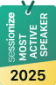
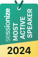
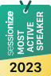

<!-- _class: lead -->
<!-- _paginate: false -->

<h1 class="cover-title">Aspire: de cero a las últimas novedades de Aspire 17.0</h1>

## Dos APIs, una base de datos, Redis y un modelo mental que escala

**Emiliano Montesdeoca del Puerto**

<p class="event-name">.NET Conf 2026 (En Español) · Virtual DEV Show · 25 de noviembre · 16:00</p>

<!--
TIEMPO: 0:00 – 0:30

Dar la bienvenida al evento y presentar la promesa: empezar con una carpeta vacía, construir una
aplicación distribuida muy pequeña y, después, recorrer lo nuevo de Aspire 17.0.

Aclarar una cosa importante: la sesión propuesta originalmente decía Aspire 13.6. Entre el envío y
el evento salió Aspire 17.0, así que hoy mostramos la versión vigente.
-->

---

<!-- _class: bio -->

## Hola, soy Emi

<div class="bio-layout">
  <div class="bio-copy">
    <ul>
      <li>Uruguayo, canario de adopción</li>
      <li>Cloud Solutions Team Lead · Intelequia</li>
      <li>Microsoft MVP en Developer Technologies desde 2022</li>
      <li>Me interesa reducir el “tiempo hasta primera ejecución” de los equipos</li>
    </ul>
    <div class="bio-badges">
      
      
      
      
    </div>
  </div>
  
</div>

<!--
TIEMPO: 0:30 – 2:00

Presentación breve. No convertirla en un currículum. Conectar la charla con una preocupación real:
que una persona nueva pueda clonar, ejecutar y entender el sistema sin recibir instrucciones de
configuración repartidas por chat, tickets y documentos desactualizados.
-->

---

## El recorrido de hoy

<div class="card-grid three">
  <div class="card">
    <h3>1 · Entender</h3>
    <p>Qué problema resuelve Aspire y qué piezas forman el modelo.</p>
  </div>
  <div class="card">
    <h3>2 · Construir</h3>
    <p>Dos APIs, PostgreSQL y Redis desde una carpeta vacía.</p>
  </div>
  <div class="card">
    <h3>3 · Aterrizar</h3>
    <p>Novedades de Aspire 17.0 y cómo migrar sin miedo.</p>
  </div>
</div>

<br>

> Idea guía: **la arquitectura no debería vivir solo en un diagrama**.

<!--
TIEMPO: 2:00 – 3:00

Explicar la estructura para que la audiencia sepa cuándo empieza la demo y cuándo empiezan las
novedades. La parte nueva de 17.0 no se mete artificialmente en la demo: primero enseñamos el modelo
fundamental y luego qué amplió esta versión.
-->

---

<!-- _class: lead hook -->

<h1>¿Por qué construir una aplicación empieza tan lejos de escribir funcionalidad?</h1>

<!--
TIEMPO: 3:00 – 4:00

Dejar dos segundos para pensar. Pedir por manos o chat: ¿cuántas terminales, contenedores, cadenas de
conexión y pasos de “lee el README” hacen falta antes de probar una funcionalidad?
-->

---

<!-- _class: components -->

## Una aplicación es más que el código

<div class="component-grid">
  <div class="component-card">Servicios</div>
  <div class="component-card">Bases de datos</div>
  <div class="component-card">Mensajería</div>
  <div class="component-card">Caché</div>
  <div class="component-card">Puertos</div>
  <div class="component-card">Secretos</div>
  <div class="component-card">Entornos</div>
  <div class="component-card">Dependencias</div>
  <div class="component-card">Health checks</div>
  <div class="component-card">Logs y trazas</div>
  <div class="component-card">Despliegue</div>
  <div class="component-card">Onboarding</div>
</div>

<br>

**El problema no es que existan. El problema es conectarlas una y otra vez.**

<!--
TIEMPO: 4:00 – 5:30

Recorrer solo tres grupos: ejecución, configuración y observación. No hace falta tener todos los
elementos. La propuesta de Aspire es dar a esas relaciones un lugar compartido.
-->

---

## El coste oculto del “ya casi funciona”

<div class="cols">
<div>

### Lo que repetimos

- Ejecutar proyectos en el orden correcto
- Descubrir puertos que cambian
- Copiar cadenas de conexión
- Esperar a que una dependencia esté lista
- Correlacionar logs entre servicios

</div>
<div>

### Lo que se rompe

- El README envejece
- Cada portátil queda configurado distinto
- El entorno local no se parece al destino
- Diagnosticar lleva más que corregir
- El onboarding depende de una persona

</div>
</div>

<!--
TIEMPO: 5:30 – 7:30

Enfatizar que Docker Compose resuelve parte del problema de contenedores, pero no toda la experiencia:
la aplicación, el código, la configuración, los health checks y la observabilidad siguen siendo una
responsabilidad dispersa. Aspire trabaja una capa por encima.
-->

---

## Aspire, en una frase

# Una forma **code-first** de describir, ejecutar y observar sistemas distribuidos.

Aspire conecta:

1. lo que forma tu aplicación
2. qué necesita cada recurso
3. cómo se arranca, se diagnostica y se publica

<!--
TIEMPO: 7:30 – 9:00

Definición deliberadamente sencilla. “Code-first” significa que la topología se versiona junto al
código y se revisa como cualquier otra modificación. No significa que Aspire sea un framework
obligatorio para todos los servicios.
-->

---

## Qué es… y qué no es

<div class="cols">
<div class="card">

### Sí

- Orquestación para desarrollo
- Modelo de recursos y relaciones
- Integraciones y configuración
- Dashboard de observabilidad
- Artefactos de despliegue

</div>
<div class="card">

### No

- Un reemplazo de ASP.NET Core
- Un proveedor cloud
- Un runtime al que migrar todo
- Una obligación de usar contenedores
- Una abstracción que oculta todo

</div>
</div>

<!--
TIEMPO: 9:00 – 10:30

Aspire no sustituye Kubernetes, Azure Container Apps, ASP.NET Core o Docker Compose. Puede orquestar
proyectos y contenedores localmente y generar artefactos para distintos destinos. Si el equipo no se
beneficia del problema de composición, tampoco hay que usarlo por obligación.
-->

---

## Las cuatro piezas que conviene recordar

<div class="card-grid">
  <div class="card">
    <h3>AppHost</h3>
    <p>El modelo ejecutable: recursos, dependencias, endpoints y destino.</p>
  </div>
  <div class="card">
    <h3>Integraciones</h3>
    <p>Paquetes que unen aplicaciones con PostgreSQL, Redis, Azure, Kafka, etc.</p>
  </div>
  <div class="card">
    <h3>Service Defaults</h3>
    <p>Observabilidad, health checks, descubrimiento y resiliencia comunes.</p>
  </div>
  <div class="card">
    <h3>Dashboard + CLI</h3>
    <p>Ejecutar, explorar, describir, diagnosticar, publicar y desplegar.</p>
  </div>
</div>

<!--
TIEMPO: 10:30 – 12:00

Estas cuatro piezas son el mapa mental de toda la sesión. En la demo veremos las cuatro, pero el
AppHost será el protagonista.
-->

---

## El AppHost: arquitectura legible

<div class="cols-wide">
<div>

```csharp
var builder = DistributedApplication.CreateBuilder(args);

var database = builder.AddPostgres("postgres")
    .AddDatabase("aspiredemo");

var subApi = builder.AddDotnetProject(
        "sub-api", "../SubApi/SubApi.csproj")
    .WithReference(database)
    .WaitFor(database);

var cache = builder.AddRedis("cache");

builder.AddDotnetProject("api", "../Api/Api.csproj")
    .WithReference(subApi)
    .WithReference(cache);

builder.Build().Run();
```

</div>
<div>

**Lo que declara**

- 5 recursos
- 3 dependencias
- 1 orden de arranque
- 0 cadenas de conexión copiadas

</div>
</div>

<!--
TIEMPO: 12:00 – 14:30

Leerlo de arriba abajo como un diagrama. Los recursos son objetos; las relaciones son llamadas.
Aspire inyecta la configuración resultante en los consumidores. En Aspire 17 usaremos AddDotnetProject
con una ruta, la API recomendada frente a la antigua AddProject<TProject>.
-->

---

## Tres verbos que parecen iguales

| Llamada | Qué expresa |
|---|---|
| `WithReference(resource)` | “Necesito conectarme a este recurso” |
| `WaitFor(resource)` | “No me arranques hasta que esté sano” |
| `WithHttpHealthCheck(path)` | “Esta es la condición para considerarme listo” |

<br>

`WithReference(subApi)` **no implica necesariamente** esperar.

<!--
TIEMPO: 14:30 – 16:00

Este matiz evita muchos errores. Referencia es configuración y dependencia lógica; WaitFor es una
política de arranque. El health check es el criterio que debe cumplirse.
-->

---

## Qué ocurre al ejecutar `aspire run`

1. Lee el **modelo del AppHost**
2. Crea los contenedores que necesita
3. Inyecta endpoints y credenciales como configuración
4. Arranca según `WaitFor` y health checks
5. Recoge logs, métricas y trazas
6. Abre un Dashboard con toda la ejecución

<!--
TIEMPO: 16:00 – 17:30

No entrar todavía en los comandos. La idea es que una orden única levanta un sistema compuesto. Si
algo falla, el problema y la dependencia aparecen en el mismo lugar.
-->

---

## Observabilidad que atraviesa la solución

<div class="architecture">
  <div class="resource"><strong>API</strong><small>HTTP + Redis</small></div>
  <div class="arrow">→</div>
  <div class="resource"><strong>SubApi</strong><small>HTTP + PostgreSQL</small></div>
  <div class="arrow">→</div>
  <div class="resource"><strong>Base de datos</strong><small>Npgsql</small></div>
</div>

Con Service Defaults y las integraciones cliente:

- un `trace` conecta la petición completa
- Redis y PostgreSQL son dependencias instrumentadas
- los health checks reflejan si el sistema está realmente listo

<!--
TIEMPO: 17:30 – 19:00

La telemetría no es mágica: viene de Service Defaults y de la instrumentación de las integraciones.
El valor es que no hay que repetirla a mano en cada servicio.
-->

---

<!-- _class: lead hook -->
<!-- _paginate: false -->

<h1>IT'S DEMO TIME</h1>

<!--
TIEMPO: 19:00 – 41:30

Cambiar a la terminal y dejar esta slide fuera del flujo visual. La demo completa se ejecuta en vivo:
crear la solución, conectar las dos APIs, añadir PostgreSQL, añadir Redis, mostrar observabilidad y,
si hay tiempo, publicar a Docker Compose.

No hay que mostrar comandos en las slides; el guion privado completo está en DEMO.md.
-->

---

<!-- _class: lead new17 -->
<!-- _paginate: false -->

<h1>Aspire 17.0</h1>

## Lo que cambia después de 13.6

<!--
TIEMPO: 41:30 – 42:00

Transición explícita: hasta ahora era una demo válida para entender Aspire. Lo siguiente viene del
release publicado el 17 de noviembre de 2026.
-->

---

<!-- _class: new17 -->

<p class="eyebrow">Novedad 1</p>

## Dashboard rediseñado

- Página inicial en **tabla de recursos**
- Vista **All resources** con salud, errores, p95 y actividad
- Grafo de dependencias junto al recurso seleccionado
- Página propia de **Terminals**
- Métricas como tarjetas con sparklines
- Exportación del grafo a Mermaid

```bash
aspire describe --format mermaid
```

<!--
TIEMPO: 42:00 – 43:30

Conectar el Dashboard visto en la demo con las mejoras. Mencionar que la experiencia anterior puede
estar disponible temporalmente en Settings. El grafo Mermaid se puede pegar en documentación o PRs.
-->

---

<!-- _class: new17 -->

<p class="eyebrow">Novedad 2</p>

## La CLI se convierte en una superficie de trabajo

- Autocompletado para Bash, Fish, PowerShell y Zsh
- Secretos separados por entorno
- Fuentes de plantillas, integraciones y skills para equipos
- `aspire update --self` y `aspire update`
- Complemento de bandeja en vista previa para AppHosts locales

```bash
aspire completions script bash > aspire-completion.bash
aspire secret set Parameters:password \
  --environment production \
  --envvar DATABASE_PASSWORD
```

<!--
TIEMPO: 43:30 – 45:00

No mostrar todos. Destacar que la CLI ya no es solo new/run: también administra plantillas, fuentes,
secretos y actualizaciones. “Tray” sigue siendo preview.
-->

---

<!-- _class: new17 -->

<p class="eyebrow">Novedad 3</p>

## Go AppHosts en vista previa

- Sin feature flag de Go
- Plantillas `aspire-go-empty` y `aspire-go-starter`
- Debug en VS Code con Delve
- `aspire doctor` comprueba Go 1.26+
- Exportación y búsqueda del SDK de Go

Java, Python y Rust continúan con características polyglot experimentales.

<!--
TIEMPO: 45:00 – 46:00

La gran noticia es Go AppHost, no que toda la plataforma polyglot sea estable. Java, Python y Rust
siguen siendo previews/experimentales. Separar claramente el estado de disponibilidad.
-->

---

<!-- _class: new17 -->

<p class="eyebrow">Novedad 4</p>

## VS Code: depurar y entender sin reiniciar

- Adjuntar el depurador a recursos .NET y Go ya arrancados
- Herramientas para que agentes de código consulten estado seguro
- Explicar el último fallo de arranque
- Abrir Dashboard y Output desde la herramienta
- Saber si Hot Reload aplica al recurso

<p class="small">Los resultados evitan exponer tokens, URLs privadas, variables y logs completos.</p>

<!--
TIEMPO: 46:00 – 47:00

Conectar con la experiencia de desarrollo actual, sin prometer que un agente corrige todo. La
extensión ofrece contexto acotado y acciones explícitas; no sustituye el control del desarrollador.
-->

---

<!-- _class: new17 -->

<p class="eyebrow">Novedad 5</p>

## AppHost 17: menos experimental, más explícito

- Mínimo del AppHost: **.NET 10**
- `AddDotnetProject` establece el modelo por ruta recomendado
- `Aspire.AppHost.Sdk` queda obsoleto, no eliminado
- Parámetros opcionales con `AsOptional()`
- Orígenes del navegador para CORS y redirecciones
- Muchas APIs dejan de requerir supresiones experimentales

```csharp
var messagePrefix = builder
    .AddParameter("message-prefix")
    .AsOptional();
```

<!--
TIEMPO: 47:00 – 48:30

Explicar que .NET 10 es el mínimo del AppHost; no obliga a que todos los workloads sean .NET 10.
Aspire 17 hace explícitos los cambios necesarios antes de actualizar: modelo de proyecto y SDK del
AppHost.
-->

---

<!-- _class: new17 -->

<p class="eyebrow">Novedad 6</p>

## Integraciones y despliegue

<div class="card-grid">
  <div class="card">
    <h3>Microsoft Entra ID · vista previa</h3>
    <p>Registros de aplicaciones y referencias para los consumidores.</p>
  </div>
  <div class="card">
    <h3>Azure API Management · vista previa</h3>
    <p>Modelar APIs, backends y políticas como recurso de despliegue.</p>
  </div>
  <div class="card">
    <h3>Azure AI clients</h3>
    <p>Nuevos paquetes sobre el SDK oficial de OpenAI.</p>
  </div>
  <div class="card">
    <h3>Kubernetes · estable</h3>
    <p>Hosting y Azure Kubernetes en versión estable; requiere Helm 4.</p>
  </div>
</div>

<!--
TIEMPO: 48:30 – 50:00

API Management es deployment-only; en aspire run los servicios pueden funcionar sin él. Kubernetes
está estable como paquete, aunque algunas APIs, como persistent volumes, siguen experimentales.
-->

---

<!-- _class: new17 compact -->

<p class="eyebrow">Novedad 7</p>

## Imágenes y migraciones que te afectan

| Integración | Aspire 13.6 | Aspire 17.0 |
|---|---:|---:|
| PostgreSQL | 18.3 | **18.6** |
| Redis | 8.6 | **8.10** |
| MongoDB | 8.3 | **9.0** |
| pgAdmin | 9.15 | **9.19** |

Cambios incompatibles a revisar:

- `AddProject<T>` queda obsoleto, preferir `AddDotnetProject`
- `Aspire.AppHost.Sdk` queda obsoleto
- clientes legacy de RabbitMQ y MongoDB eliminados
- paquetes de Azure AI antiguos reemplazados
- banderas de características polyglot renombradas

<!--
TIEMPO: 50:00 – 51:30

Advertir especialmente sobre MongoDB 9.0 en volúmenes persistentes: revisar sus notas o fijar la
versión anterior con WithImageTag. No actualizar blind a la imagen latest; Aspire 17 fija versiones
predeterminadas conocidas.
-->

---

## Actualizar sin perder el control

```bash
aspire update --self
aspire update
```

Después:

1. Leer los breaking changes
2. Quitar supresiones de APIs ya estables
3. Reemplazar `AddProject<T>` por `AddDotnetProject`
4. Migrar `Aspire.AppHost.Sdk` cuando toque
5. Compilar, ejecutar y revisar la publicación

<p class="small">El cambio de versión es también un cambio de contrato de desarrollo.</p>

<!--
TIEMPO: 51:30 – 52:30

No recomendar ejecutar update sin leer los cambios. El CLI automatiza paquetes; el AppHost requiere
revisión porque algunas migraciones no son automáticas.
-->

---

## Cuándo encaja Aspire

<div class="cols">
<div>

### Muy buen encaje

- 2+ servicios o procesos
- infraestructura local repetible
- diagnóstico distribuido
- onboarding frecuente
- varios destinos de publicación

</div>
<div>

### Evalúa el coste

- una sola aplicación sencilla
- políticas internas muy rígidas
- integración ya resuelta con otra plataforma
- equipo que no necesita modelo local compartido

</div>
</div>

<!--
TIEMPO: 52:30 – 53:30

No vender Aspire como requisito universal. Es especialmente útil cuando la complejidad ya está en la
composición. La demo usa cuatro dependencias para hacerlo visible con poco código.
-->

---

## Tres ideas para llevarte

1. **Modela la aplicación**, no solo cada proyecto.
2. **Usa las mismas relaciones** para arrancar, observar y publicar.
3. **Prueba Aspire 17 sobre un problema real** antes de rediseñar el sistema.

```bash
dotnet new aspire
aspire run
```

<p class="small">Guion completo: <code>DEMO.md</code> · Código final: <code>src/</code></p>

<!--
TIEMPO: 53:30 – 55:00

Cerrar el contenido antes de las preguntas. Si el formato real reserva cinco minutos, arrancar Q&A
al minuto 55; estas frases deben poder omitirse sin perder el mensaje.
-->

---

<!-- _class: lead -->
<!-- _paginate: false -->

# Gracias

## ¿Preguntas?

**Emiliano Montesdeoca**

linkedin.com/in/emimontesdeoca · @emimontesdeocaa

<p class="small">
  <a href="https://aspire.dev/whats-new/aspire-17/">Notas de Aspire 17.0</a> ·
  <a href="https://www.meetup.com/virtualdevshow/events/316451194/">Evento</a>
</p>

<!--
TIEMPO: 55:00 – 60:00

Preguntas previsibles:
- ¿Aspire necesita .NET 11? No. Aspire 17 requiere como mínimo .NET 10 para el AppHost; los workloads
  pueden usar otros lenguajes y frameworks.
- ¿Puedo usar Aspire sin Azure? Sí. La demo es 100 % local y se publica a Docker Compose.
- ¿Sustituye a Docker Compose? Puede publicar uno, pero su valor principal es el modelo unificado.
- ¿Aspire es solo local? No. También modela y publica destinos de despliegue; el Dashboard puede
  incluirse en artefactos de Compose y Kubernetes.
- ¿Qué pasa con Aspire 13.6? Es una versión anterior. Para una sesión nueva conviene enseñar 17.0 y
  seguir la guía de actualización.
- ¿Por qué no EF Core? Para mantener la demo mínima y enseñar la integración de conexión Npgsql.

Si no se conoce una respuesta: anotarla y responder después con la documentación oficial enlazada.
-->
